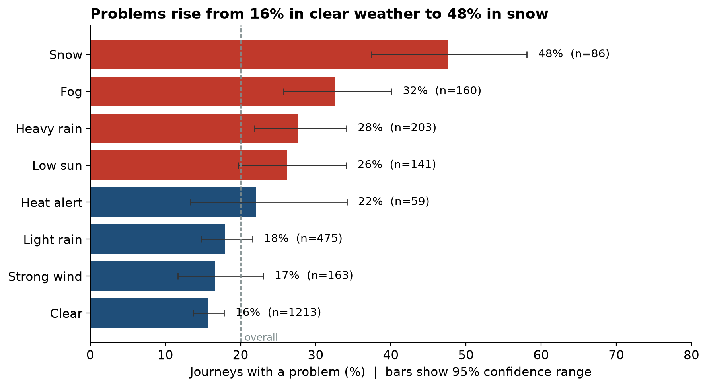
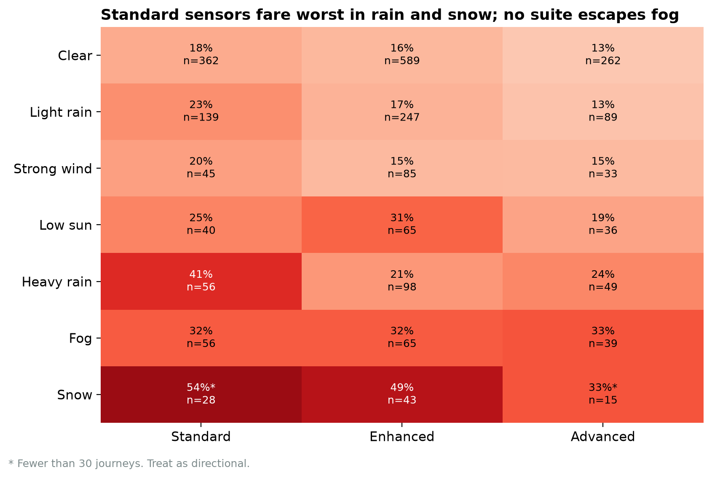
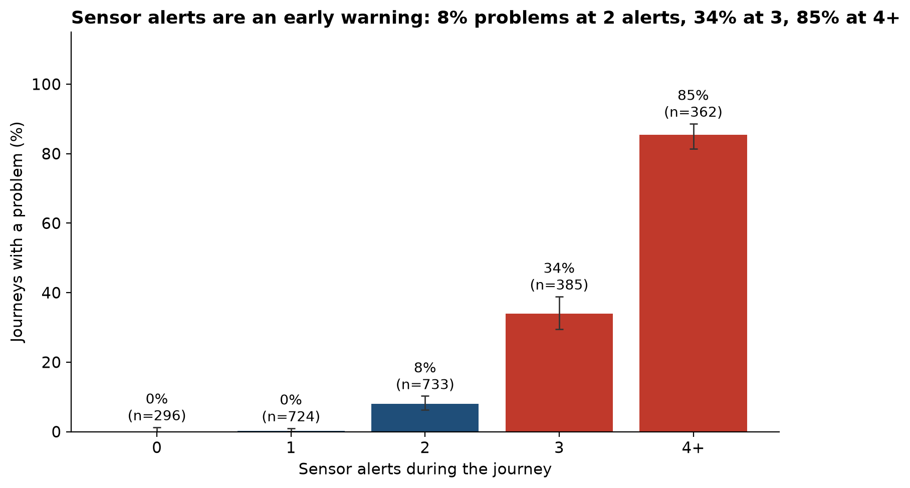
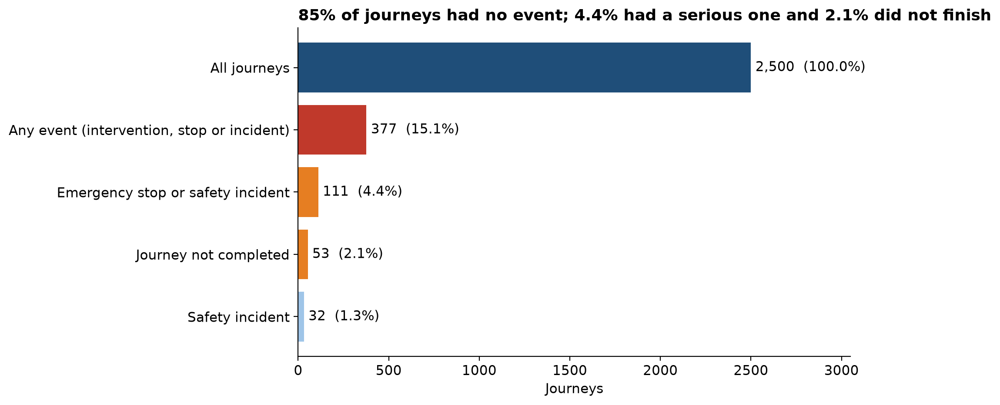

# Can We Trust the Ride? Autonomous vehicle trust analysis

A data science project for the Project ROUTE *Step Up* Data Science & AI career challenge. It asks whether autonomous vehicles can be trusted, using a synthetic dataset of 2,500 journeys, and ends in a conditional trust decision backed by evidence.

**Author:** Catherine Wanjiku Waweru

> **Data note:** the data is synthetic learning data supplied by the challenge. It does not describe real vehicles, roads, passengers or safety performance. Patterns are associations, not causes, and nothing here should inform real transport or safety decisions.

## The answer in brief

**Conditional trust: human oversight in bad weather, and no unsupervised rides in snow.**

- **Weather is strongly linked to problems.** The problem rate rises from 15.7% in clear weather to 47.7% in snow (fog 32.5%, heavy rain 27.6%). Sensor confidence falls 21 points below its normal level in snow and 14 in fog.
- **Sensor alerts are an early warning.** Problems are about 0% with 0-1 alerts, 8% at 2, 34% at 3 and 85% at 4 or more.
- **A model can detect trouble during a journey but cannot forecast it.** In-journey logistic regression catches about 83% of problems (cross-validated); using only conditions known at departure it catches 7%.
- **Failures are mostly recoverable, but not all.** 85% of journeys had no event, 4.4% had an emergency stop or safety incident and 2.1% did not finish. Only 28% of journeys whose most serious event was a safety incident were completed.

## Key figures

| | |
|---|---|
|  |  |
|  |  |

## Model results

Target: `problem_occurred` (501 problems in 2,500 journeys, 20.0%). Models: logistic regression and a depth-4 decision tree, with a "always no problem" baseline. 80/20 stratified split, `random_state=42`, 500 test journeys.

| Model and evaluation | Accuracy | Precision | Recall |
|---|---|---|---|
| Baseline: always "no problem" | 80.0% | 0% | 0% |
| Pre-journey logistic regression, test split | 81.4% | 100%* | 7% |
| In-journey logistic regression, test split | 96.6% | 91.1% | 92.0% |
| In-journey decision tree, test split | 97.2% | 95.7% | 90.0% |
| **In-journey logistic regression, 5-fold cross-validation (all 2,500)** | **95.2%** | **92.3%** | **83.2%** |

\*Based on only 7 warnings. Test-split confusion matrix (in-journey logistic): 391 true negatives, 9 false alarms, 8 missed problems, 92 caught.

- **Pre-journey** features are conditions known at departure. **In-journey** adds live sensor confidence, alert count and the obstacle flag.
- Accuracy alone is misleading: a model that always says "no problem" scores 80%.
- The single test split was favourable; cross-validation (83% recall) is the steadier estimate.
- A simple operator rule, "escalate to a human at 3 or more alerts", catches about 88% of problems with about 12 false alarms per 100 journeys.
- Outcome fields (interventions, stops, incidents, completion, delay, rating, `risk_level`) are excluded as leakage.

## Safeguards and fairness

- Cross-validated miss rates differ by condition: 20.5% of clear-weather problems are missed, against 12-14% in rain, fog and low sun. Snow produces the most false alarms (8.9%).
- City and road-type gaps (for example Bristol and B roads) rest on roughly 80-105 problems each and are unproven.
- There is no passenger information beyond one rating, so fairness across passenger groups cannot be tested.

## Data quality notes

- All files join without changing the 2,500-row count; no missing values or duplicates.
- `intervention_events.csv` holds **one row per journey: its most serious event** (safety incident, then emergency stop, then human intervention). 82 journeys have several flags but a single row, so event counts by type understate interventions.
- 9 events say "Journey terminated" but "Journey completed". They are kept and listed in `reports/red_flag_table.csv`; removing them changes test recall from 92.0% to 90.6%.
- The label `problem_occurred` is closely tied to alert count and sensor confidence, so the in-journey model partly recovers how the label was built.

## Limitations

- Synthetic, observational data: associations only.
- Small groups: snow (86 journeys) and heat alert (59).
- The model detects problems as they happen; before departure it barely beats the baseline.
- Evidence still needed: real-world trials with many more snow and fog journeys, consented passenger data, and signals available before departure.

## Project structure

```
data/raw/          challenge CSV files (not included, see "Data" below)
data/processed/    journeys_merged.csv (created by 01_load_join.py)
src/               analysis scripts, run in order
notebooks/         02_data_checks.ipynb (data validation)
figures/           PNG charts
reports/           text and CSV reports written by the scripts
```

| Script | Purpose | Output |
|---|---|---|
| `01_load_join.py` | Load, check and join the files | `data/processed/journeys_merged.csv` |
| `02_checks.py` | Data validation | `reports/data_validation_report.txt` |
| `02b_red_flags.py` | Anomaly audit | `reports/red_flag_table.csv` |
| `03_explore.py` | Weather, hardware, alerts, passenger cost | figures 01-06, `reports/exploration_summary.txt` |
| `04_events.py` | Does the system fail safely? | figures 07-09, `reports/events_analysis_summary.txt` |
| `05_model.py` | Models, cross-validation, thresholds, fairness | figures 10-14, `reports/model_evaluation_report.txt` |

## How to run

1. Install Python 3.11 or later and the packages: `pip install pandas numpy matplotlib scikit-learn`.
2. Put the challenge CSV files in `data/raw/` (see "Data").
3. From the project root, run the scripts in order:
   ```
   python src/01_load_join.py
   python src/02_checks.py
   python src/02b_red_flags.py
   python src/03_explore.py
   python src/04_events.py
   python src/05_model.py
   ```
4. Open the reports in `reports/` and the charts in `figures/`.


## Data

The CSVs in `data/raw/` come from the Project ROUTE Step Up Data Science & AI challenge pack. They are synthetic learning data and do not describe real vehicles, roads or passengers. They are included here so the analysis can be rerun end to end. All credit for the dataset belongs to the challenge organisers.


